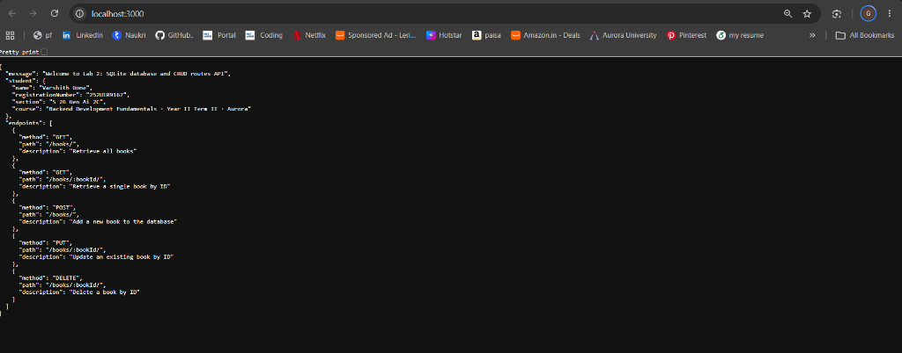
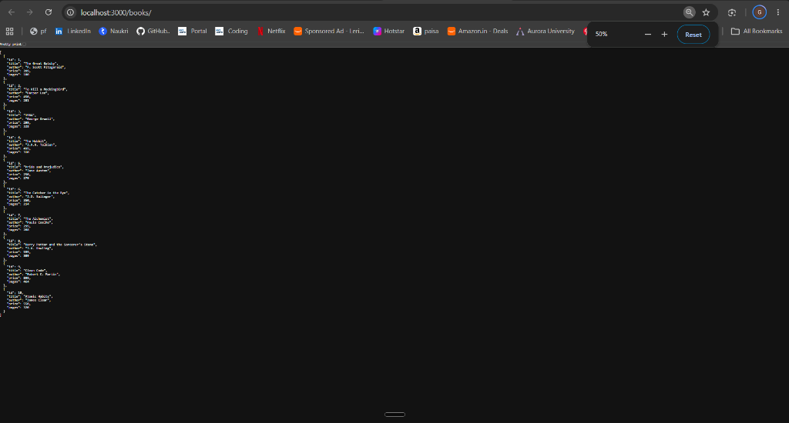
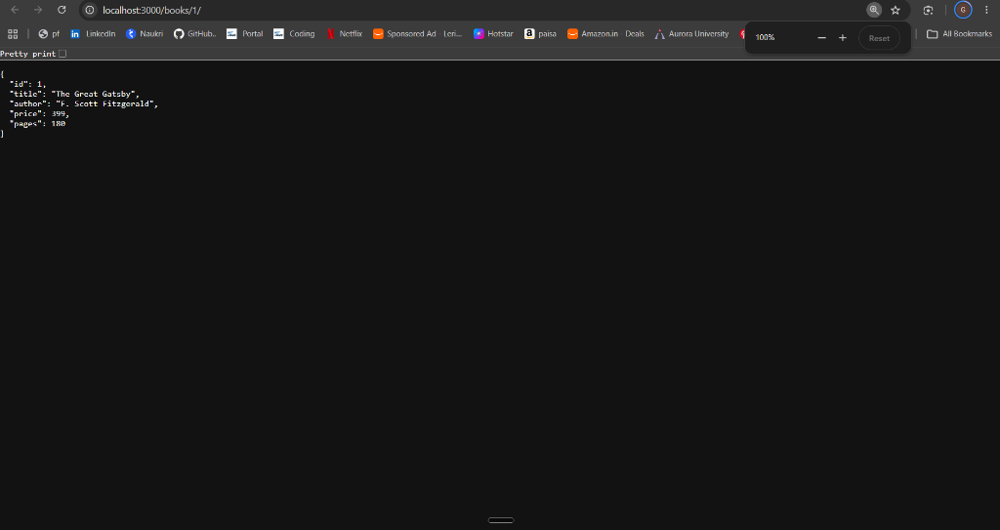
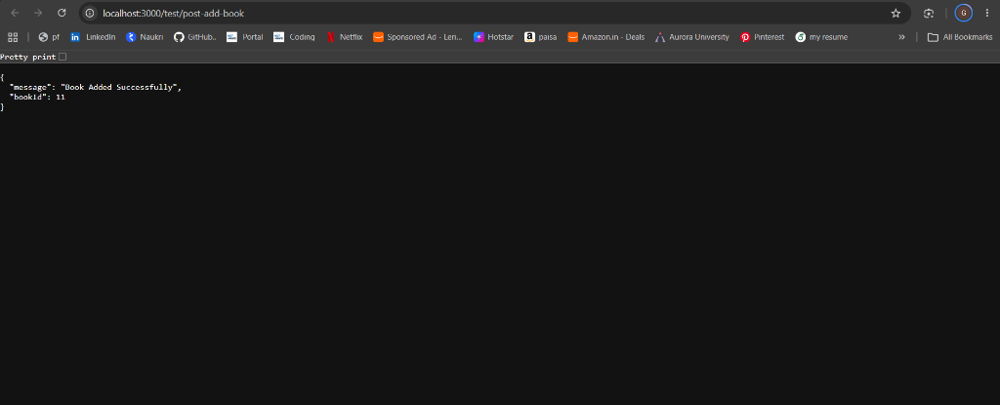
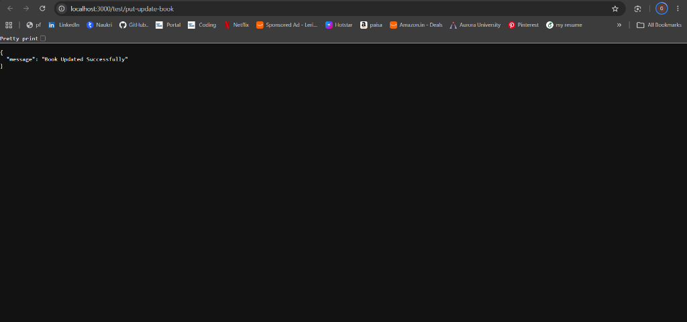
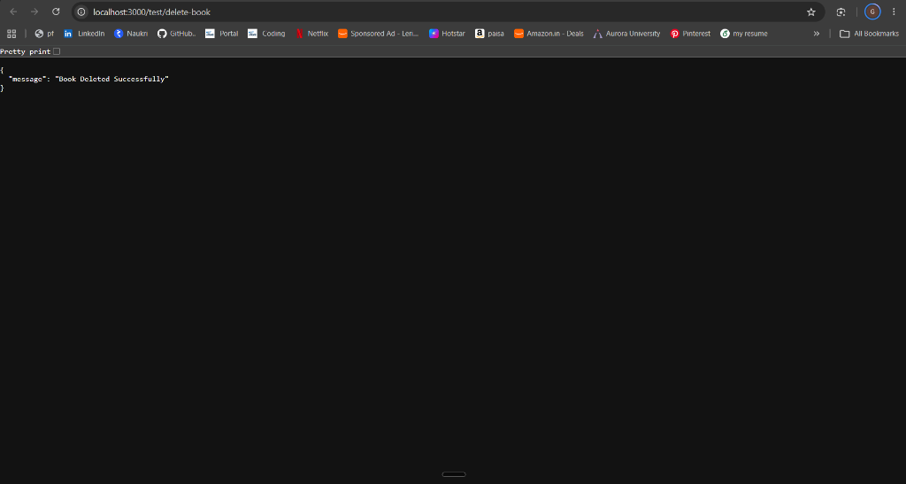
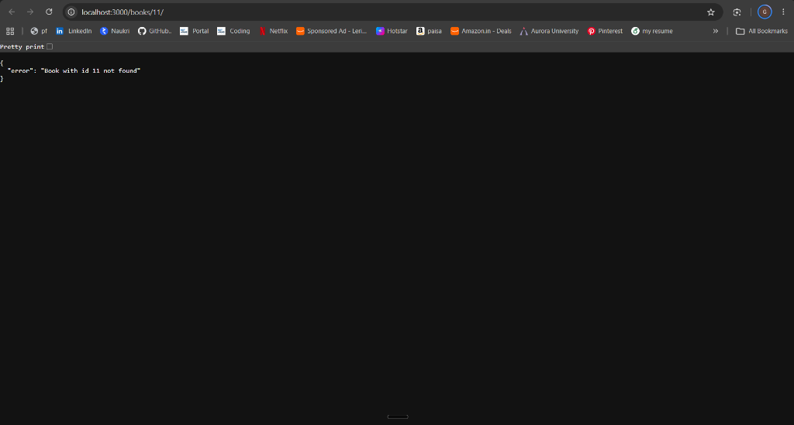
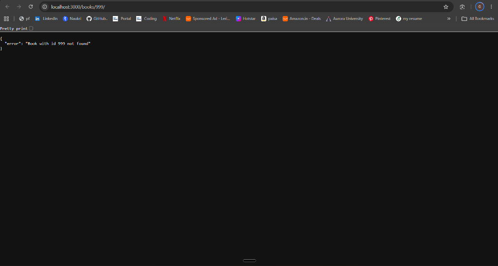

# Lab 2: SQLite database and CRUD routes

### Student Details
- **Name:** Varshith Gone
- **Registration Number:** 252U1R9167
- **Section:** S 26 Gen Ai 2C
- **Course:** Backend Development Fundamentals (Year II Term II)
- **Faculty:** Joel Prashanth D
- **Reference Repository:** [shaik-creator/Backend_development_fundamentals_lab_02](https://github.com/shaik-creator/Backend_development_fundamentals_lab_02)

---

## Live Link
- **Live Deployment:** [https://backend-development-fundamentals-la-sooty.vercel.app](https://backend-development-fundamentals-la-sooty.vercel.app)

---

## Objective
Connect an Express server to a SQLite database and expose full CRUD (Create, Read, Update, Delete) operations over HTTP using asynchronous database queries, parameterized SQL statements (`?` placeholders) to prevent SQL injection, and nodemon for automated server reloading.

---

## Project Structure

```text
bds/
├── .gitignore
├── README.md
├── lab-01/
└── lab-02/
    ├── .gitignore
    ├── package.json
    ├── package-lock.json
    ├── book.db
    ├── init-db.js
    ├── server.js
    ├── test-endpoints.js
    ├── README.md
    └── screenshots/
        ├── 01-get-root-welcome.png
        ├── 02-get-books-all.png
        ├── 03-get-book-single.png
        ├── 04-post-add-book.png
        ├── 05-put-update-book.png
        ├── 06-delete-book.png
        ├── 07-get-book-deleted-404.png
        └── 08-get-book-404.png
```

---

## Database Schema & Table Structure

The SQLite database file is `book.db`. It contains a table named `book` defined as follows:

```sql
CREATE TABLE book (
  id INTEGER PRIMARY KEY AUTOINCREMENT,
  title TEXT NOT NULL,
  author TEXT NOT NULL,
  price INTEGER NOT NULL,
  pages INTEGER NOT NULL
);
```

### Initial Data (10 Rows)

| ID | Title | Author | Price (₹) | Pages |
|:---|:---|:---|:---|:---|
| 1 | The Great Gatsby | F. Scott Fitzgerald | 399 | 180 |
| 2 | To Kill a Mockingbird | Harper Lee | 450 | 281 |
| 3 | 1984 | George Orwell | 299 | 328 |
| 4 | The Hobbit | J.R.R. Tolkien | 499 | 310 |
| 5 | Pride and Prejudice | Jane Austen | 250 | 279 |
| 6 | The Catcher in the Rye | J.D. Salinger | 350 | 214 |
| 7 | The Alchemist | Paulo Coelho | 299 | 208 |
| 8 | Harry Potter and the Sorcerer's Stone | J.K. Rowling | 599 | 309 |
| 9 | Clean Code | Robert C. Martin | 899 | 464 |
| 10 | Atomic Habits | James Clear | 550 | 320 |

---

## How to Run

### 1. Prerequisites
- [Node.js](https://nodejs.org/) (v18 or higher recommended).
- [npm](https://www.npmjs.com/) (bundled with Node.js).
- SQLite CLI or SQLite Viewer (optional, for viewing `book.db`).

### 2. Installation
Navigate into the `lab-02` directory and install project dependencies:

```bash
cd lab-02
npm install
```

### 3. Environment Variables
- No required environment variables for local execution.
- Port defaults to `3000` (can be configured via `PORT` environment variable, e.g., `PORT=4000 npm start`).

### 4. Database Setup / Reset
To create or reset the SQLite database (`book.db`) with the 10 initial rows:

```bash
npm run init-db
```

### 5. Starting the Server

#### Development Mode (with nodemon auto-restart):
```bash
npm run dev
```

#### Production Mode:
```bash
npm start
```

The server will output:
```text
Server running at http://localhost:3000/
```

### 6. Automated Endpoint Testing
To execute automated verification across all CRUD routes:
```bash
npm run test:endpoints
```

---

## Endpoints Table

| HTTP Method | Route / Endpoint | Description | Request Body | Status Code | Response Type |
|:---|:---|:---|:---|:---|:---|
| `GET` | `/` | API Overview & student details | None | `200 OK` | `application/json` |
| `GET` | `/books/` | Retrieve all books from database | None | `200 OK` | `application/json` |
| `GET` | `/books/:bookId/` | Retrieve a single book by ID | None | `200 OK` / `404 Not Found` | `application/json` |
| `POST` | `/books/` | Add a new book to the database | `{ title, author, price, pages }` | `201 Created` / `400 Bad Request` | `application/json` |
| `PUT` | `/books/:bookId/` | Update an existing book by ID | `{ title, author, price, pages }` | `200 OK` / `404 Not Found` | `application/json` |
| `DELETE` | `/books/:bookId/` | Remove a book by ID | None | `200 OK` / `404 Not Found` | `application/json` |

---

## Screenshots & Verification

All CRUD endpoints were verified directly against the live Express server in Google Chrome:

### 1. GET `/` (Root Welcome & Student Metadata)
- **Status:** `200 OK`
- Returns API overview and student information (`Varshith Gone · 252U1R9167 · Joel Prashanth D`).



---

### 2. GET `/books/` (Retrieve All Books)
- **Status:** `200 OK`
- Retrieves the full array of initial seeded records from SQLite.



---

### 3. GET `/books/:bookId/` (Retrieve Single Book)
- **Status:** `200 OK`
- Retrieves book details for ID `1` using parameterized SQL with `?` placeholder.



---

### 4. POST `/books/` (Add New Book)
- **Status:** `201 Created`
- Inserts a new book into SQLite and returns the assigned `bookId: 11`.



---

### 5. PUT `/books/:bookId/` (Update Book Details)
- **Status:** `200 OK`
- Updates book details in SQLite for ID `11`.



---

### 6. DELETE `/books/:bookId/` (Remove Book)
- **Status:** `200 OK`
- Removes book ID `11` from the SQLite database.



---

### 7. GET `/books/:bookId/` (Verification of Deletion - 404 Not Found)
- **Status:** `404 Not Found`
- Confirms that the deleted book ID `11` is no longer present.



---

### 8. GET `/books/999/` (Arbitrary Non-Existent ID - 404 Not Found)
- **Status:** `404 Not Found`
- Confirms robust error handling for unseeded IDs.



---

## Viva Questions & Answers

### 1. Why await the database call?
- SQLite database input/output (disk reads and writes) is asynchronous and handled outside the main Node.js event loop thread.
- If we do not use `await` before a database call (such as `db.all()`, `db.get()`, or `db.run()`), the JavaScript engine immediately proceeds to execute the next line before the query has finished, leaving the response variable as an unresolved `Promise { <pending> }`.
- Using `await` pauses execution of the current `async` function until the Promise resolves with the actual query results, ensuring that the HTTP response sends complete and accurate data to the client.

### 2. What is SQL injection and how do placeholders prevent it?
- **SQL Injection (SQLi)** is a cybersecurity vulnerability that occurs when untrusted user input is directly concatenated or interpolated into a raw SQL query string. An attacker can craft malicious inputs containing SQL control characters (e.g., `' OR '1'='1' --` or `'; DROP TABLE book; --`) to manipulate the query logic, bypass authentication, extract confidential data, or destroy tables.
- **Placeholders (`?`)** prevent SQL injection by using **parameterized queries (prepared statements)**. The database driver compiles and parses the query structure first with placeholder tokens. User-supplied parameters are sent separately as pure data values, never as executable SQL code. The database engine treats them strictly as literal strings or numbers, neutralising any embedded SQL syntax.

### 3. When is PUT used instead of POST?
- **`POST`** is typically used to create a new resource. The client sends data to a collection endpoint (e.g. `POST /books/`), and the server determines the new resource's identity (such as assigning an auto-incrementing `id`). Making multiple identical POST requests produces multiple new records (it is non-idempotent).
- **`PUT`** is used to completely replace or update an existing resource at a specific resource URI (e.g. `PUT /books/:bookId/`). Unlike POST, `PUT` is **idempotent**: sending the exact same `PUT` request multiple times results in the same final state of the resource on the server without creating duplicates.

---

## Notes: Problems Faced and Solutions

1. **Server Starting Before Database Connection:**
   - *Problem:* Calling `app.listen()` before SQLite opened resulted in incoming HTTP requests failing because `db` was still `null`.
   - *Solution:* Implemented `initializeDBAndServer()` as an `async` function where `db = await open(...)` must successfully resolve before `app.listen()` is invoked. If the connection fails, the process logs the error and safely exits with code 1.

2. **Preventing SQL Injection Vulnerabilities:**
   - *Problem:* Using template literals like `` `SELECT * FROM book WHERE id = ${bookId}` `` is vulnerable to SQL injection attacks.
   - *Solution:* Used parameterized queries with `?` placeholders for all dynamic inputs (`db.get(query, [bookId])`, `db.run(query, [title, author, price, pages])`).

3. **Database File Tracking vs `node_modules`:**
   - *Problem:* The lab specification requires producing and committing the SQLite `.db` file while strictly ignoring `node_modules` and any environment configurations.
   - *Solution:* Configured `.gitignore` in both root and `lab-02/` to ignore `node_modules/` and `.env`, while ensuring `book.db` is tracked in version control.

