# Lab 3: REST API, query parameters, validation, debugging

### Student Details
- **Name:** Varshith Gone
- **Registration Number:** 252U1R9167
- **Section:** S 26 Gen Ai 2C
- **Course:** Backend Development Fundamentals (Year II Term II)
- **Faculty:** Joel Prashanth D
- **Reference Repository:** [shaik-creator/Backend_development_fundamentals_lab_03](https://github.com/shaik-creator/Backend_development_fundamentals_lab_03)

---

## Live Link
- **Live Deployment:** Not applicable (Local development server running SQLite file-based database `database.db`; live Playwright browser captures provided below).

---

## Objective
Transform the SQLite CRUD server into a production-grade RESTful API featuring:
1. RESTful noun-based endpoint naming (`/books`).
2. Express query parameters for searching (`search_q`), price-range filtering (`min_price`, `max_price`), sorting (`order_by`, `order`), and pagination (`limit`, `offset`).
3. Robust request payload validation for POST/PUT requests with meaningful `400 Bad Request` JSON error messages.
4. Consistent HTTP status codes (`200 OK`, `201 Created`, `400 Bad Request`, `404 Not Found`, `500 Internal Server Error`).
5. Debugging common backend issues: port conflicts (`EADDRINUSE`), path/import issues, table name typos, and missing `await` statements.
6. Real, live screenshots captured via Playwright in Google Chrome.

---

## Project Structure

```text
bds/
├── .gitignore
├── README.md
├── lab-01/
├── lab-02/
├── lab2/
└── lab-03/
    ├── .gitignore
    ├── package.json
    ├── package-lock.json
    ├── database.db
    ├── init-db.js
    ├── server.js
    ├── test-endpoints.js
    ├── take-screenshots.js
    ├── README.md
    └── screenshots/
        ├── 01-get-books-all.png
        ├── 02-get-books-search.png
        ├── 03-get-books-filter-sort.png
        ├── 04-get-books-pagination.png
        ├── 05-get-book-single.png
        ├── 06-get-book-404.png
        ├── 07-post-validation-missing-title-400.png
        ├── 08-post-validation-invalid-price-400.png
        ├── 09-post-book-success-201.png
        ├── 10-put-book-success-200.png
        ├── 11-put-book-404.png
        ├── 12-delete-book-success-200.png
        └── 13-get-book-after-delete-404.png
```

---

## Database Schema & Table Structure

The SQLite database file is `database.db`. It contains a table named `book` defined as follows:

```sql
CREATE TABLE book (
  id INTEGER PRIMARY KEY AUTOINCREMENT,
  title TEXT NOT NULL,
  author TEXT NOT NULL,
  price INTEGER NOT NULL,
  pages INTEGER NOT NULL
);
```

### Initial Data (12 Seeded Books)

| ID | Title | Author | Price (₹) | Pages |
|:---|:---|:---|:---|:---|
| 1 | The Great Gatsby | F. Scott Fitzgerald | 399 | 180 |
| 2 | To Kill a Mockingbird | Harper Lee | 450 | 281 |
| 3 | 1984 | George Orwell | 299 | 328 |
| 4 | The Hobbit | J.R.R. Tolkien | 499 | 310 |
| 5 | Pride and Prejudice | Jane Austen | 250 | 279 |
| 6 | The Catcher in the Rye | J.D. Salinger | 350 | 214 |
| 7 | The Alchemist | Paulo Coelho | 299 | 208 |
| 8 | Harry Potter and the Sorcerer's Stone | J.K. Rowling | 599 | 309 |
| 9 | Clean Code | Robert C. Martin | 899 | 464 |
| 10 | Atomic Habits | James Clear | 550 | 320 |
| 11 | Clean Architecture | Robert C. Martin | 950 | 432 |
| 12 | Deep Work | Cal Newport | 420 | 304 |

---

## How to Run

### 1. Prerequisites
- [Node.js](https://nodejs.org/) (v18 or higher recommended).
- [npm](https://www.npmjs.com/) (bundled with Node.js).
- Google Chrome (for automated Playwright screenshots).

### 2. Installation
Navigate into the `lab-03` directory and install project dependencies:

```bash
cd lab-03
npm install
```

### 3. Environment Variables
- No required environment variables for local execution.
- Port defaults to `3000` (can be overridden via `PORT` environment variable, e.g., `PORT=4000 npm start`).

### 4. Database Initialization
To create or reset the SQLite database (`database.db`) with the 12 initial rows:

```bash
npm run init-db
```

### 5. Running the Application

#### Development Mode (nodemon auto-restart):
```bash
npm run dev
```

#### Production Mode:
```bash
npm start
```

The server will output:
```text
Server Running at http://localhost:3000/
```

### 6. Automated Testing & Screenshot Capture
- **Run automated HTTP endpoint assertions:**
  ```bash
  npm run test:endpoints
  ```
- **Capture actual browser screenshots via Playwright:**
  ```bash
  npm run take-screenshots
  ```

---

## REST Endpoints Specification

| HTTP Method | Route | Description | Query / Body Parameters | Success Status | Failure Status |
|:---|:---|:---|:---|:---|:---|
| `GET` | `/` | API Overview & student details | None | `200 OK` | `500 Internal Error` |
| `GET` | `/books` | Search, filter, sort & paginate books | `search_q`, `min_price`, `max_price`, `order_by`, `order`, `limit`, `offset` | `200 OK` | `500 Internal Error` |
| `GET` | `/books/:bookId` | Retrieve a single book by ID | Path: `:bookId` | `200 OK` | `404 Not Found` |
| `POST` | `/books` | Add a new book (with input validation) | Body: `{ title, author, price, pages }` | `201 Created` | `400 Bad Request` |
| `PUT` | `/books/:bookId` | Update an existing book | Path: `:bookId`<br>Body: `{ title, author, price, pages }` | `200 OK` | `400 Bad Request`<br>`404 Not Found` |
| `DELETE` | `/books/:bookId` | Remove a book by ID | Path: `:bookId` | `200 OK` | `404 Not Found` |

### Query Parameters for `GET /books`:

| Parameter | Type | Default Value | Description |
|:---|:---|:---|:---|
| `search_q` | String | `""` | Case-insensitive substring match against title (`LIKE %search_q%`) |
| `min_price` | Number | `0` | Minimum book price filter (`price >= min_price`) |
| `max_price` | Number | `1000000` | Maximum book price filter (`price <= max_price`) |
| `order_by` | String | `"id"` | Column to sort by (`id`, `title`, `author`, `price`, `pages`) |
| `order` | String | `"ASC"` | Sort direction (`ASC` or `DESC`) |
| `limit` | Number | `10` | Maximum number of records to return |
| `offset` | Number | `0` | Number of records to skip for pagination |

---

## Screenshots (Captured with Playwright in Google Chrome)

> All screenshots below were taken using **Playwright** controlling **Google Chrome**, sending live requests to the running Express server and SQLite database.

### 1. GET `/books` (Default Search - All Books with Limit 10)
Status: `200 OK`. Returns initial collection paginated by default.

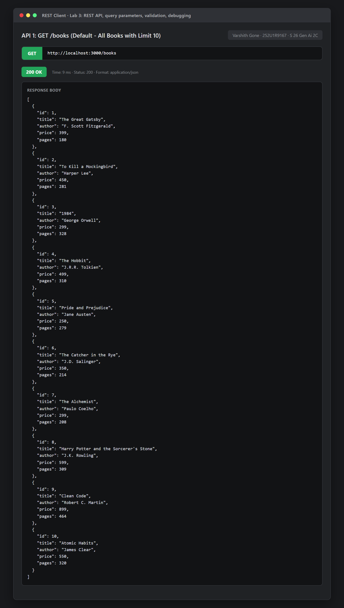

---

### 2. GET `/books?search_q=Harry` (Title Search with LIKE)
Status: `200 OK`. Filters books whose titles match substring `Harry`.

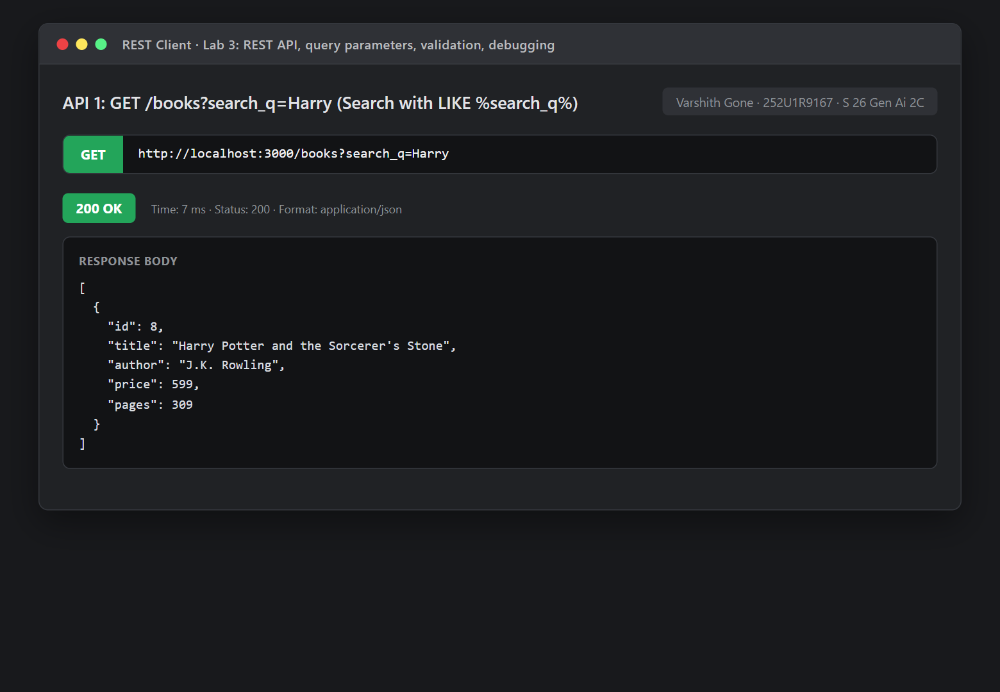

---

### 3. GET `/books?min_price=300&max_price=550&order_by=price&order=ASC` (Price Filter & Sort)
Status: `200 OK`. Returns books within the price range sorted ascending by price.

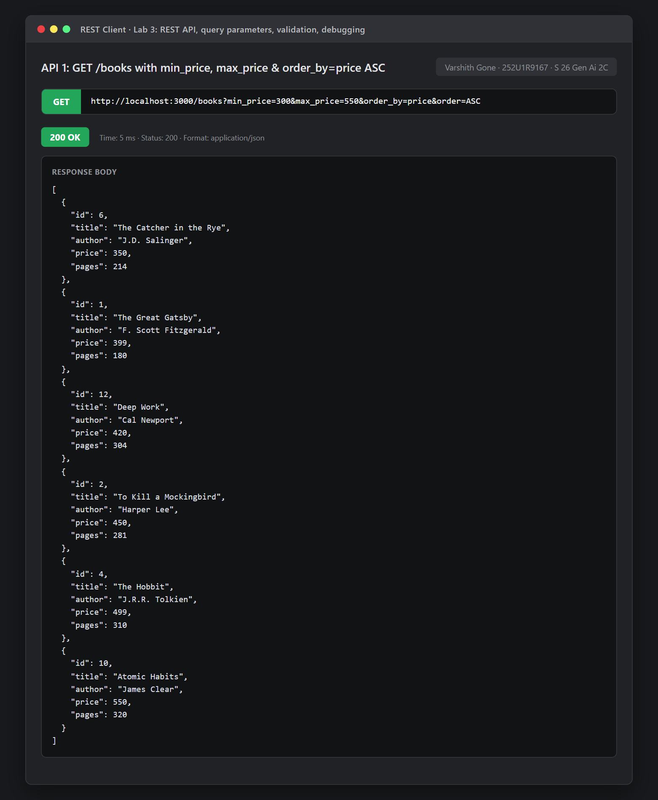

---

### 4. GET `/books?limit=3&offset=3` (Pagination)
Status: `200 OK`. Demonstrates pagination by skipping the first 3 records and returning the next 3.

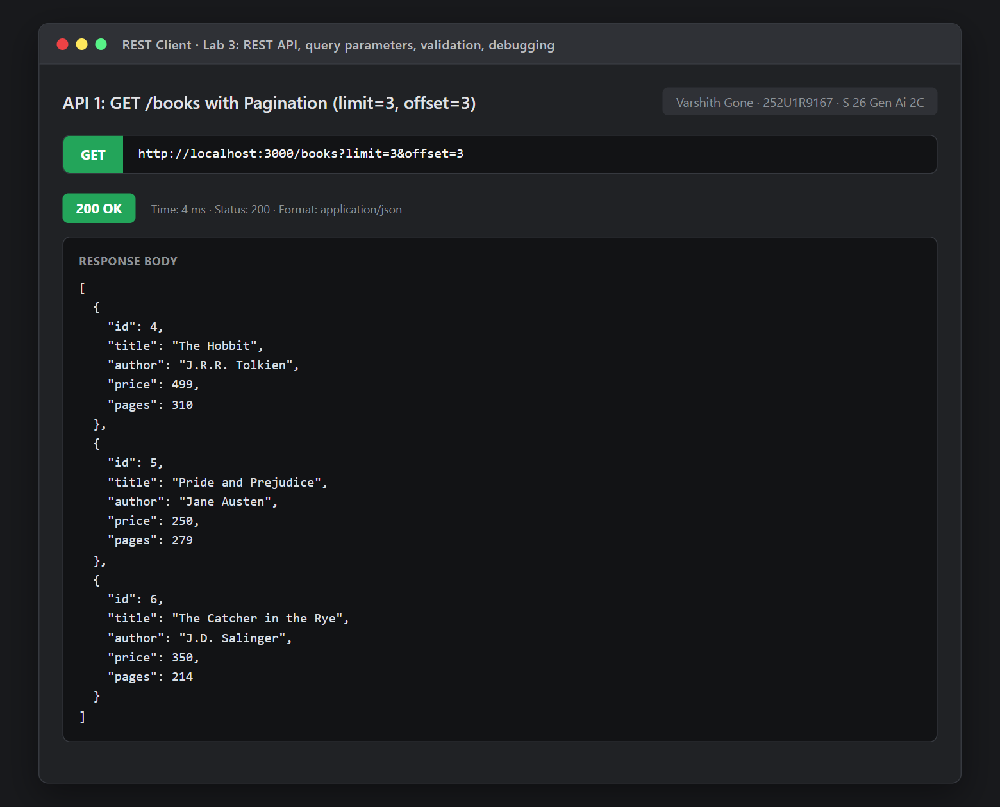

---

### 5. GET `/books/1` (Single Book Record)
Status: `200 OK`. Retrieves a specific book by primary key ID.

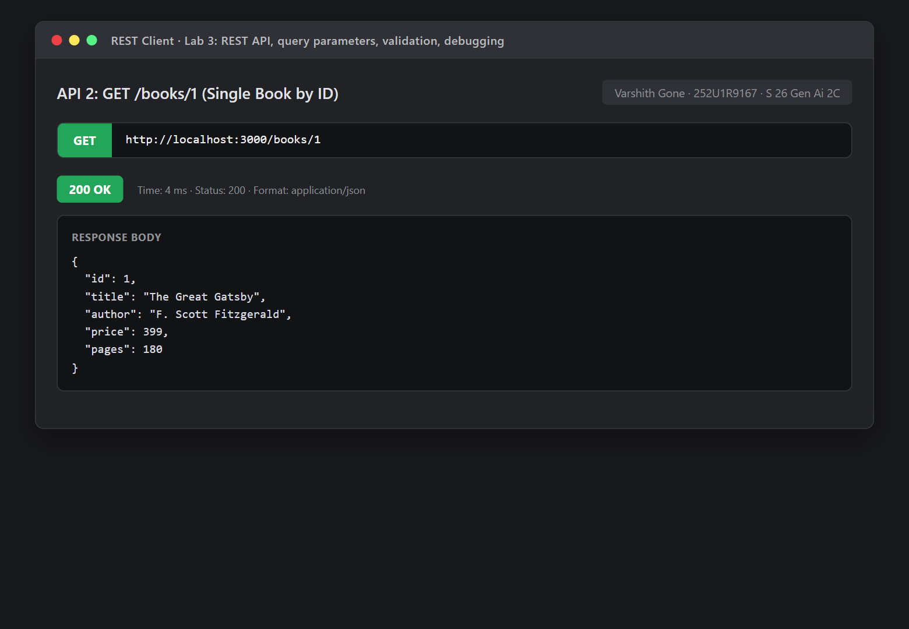

---

### 6. GET `/books/999` (404 Not Found for Non-Existent ID)
Status: `404 Not Found`. Returns consistent JSON error `{ "error": "Book Not Found" }`.

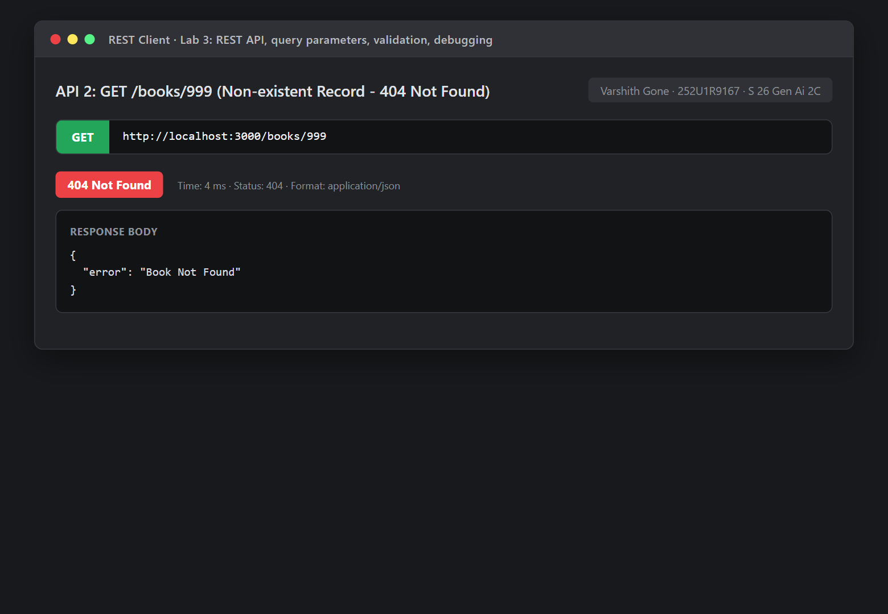

---

### 7. POST `/books` (Validation: Missing Title Rejection)
Status: `400 Bad Request`. Rejects requests missing the `title` field.

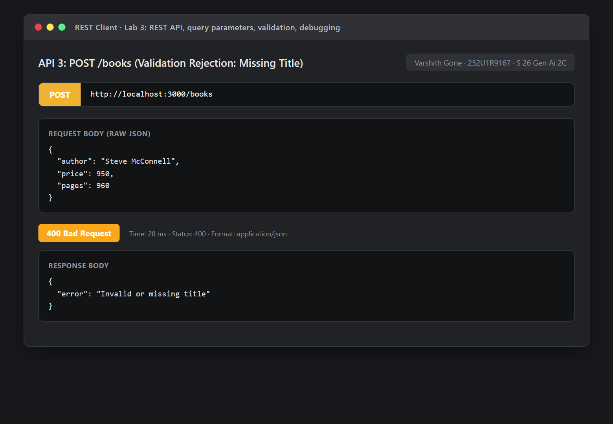

---

### 8. POST `/books` (Validation: Non-Numeric Price Rejection)
Status: `400 Bad Request`. Rejects requests when `price` is not a valid number.

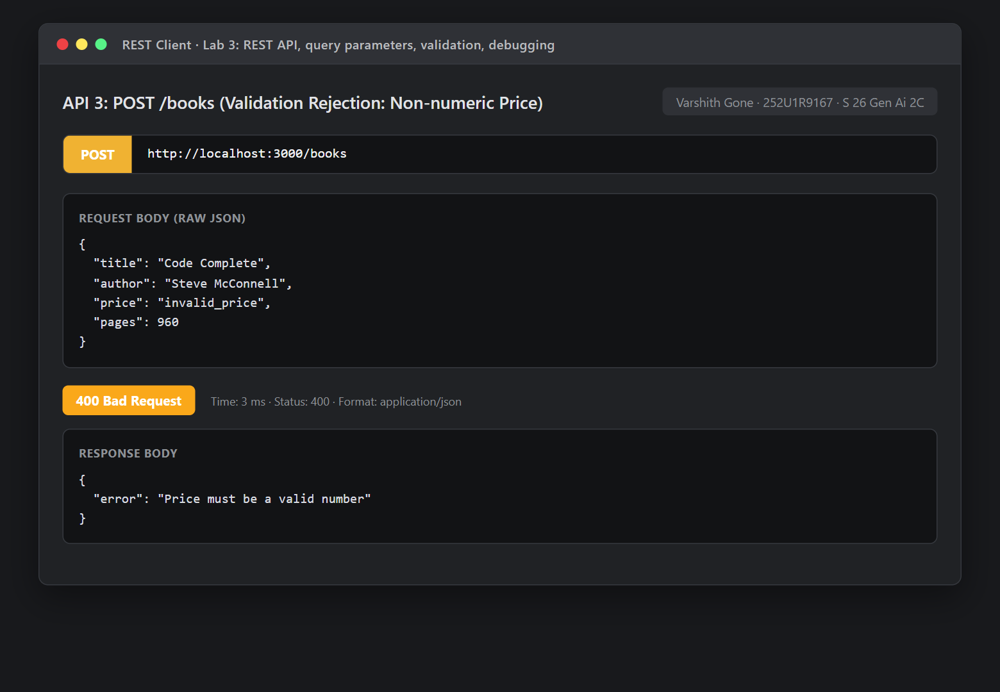

---

### 9. POST `/books` (Successful Creation)
Status: `201 Created`. Inserts record into database and returns assigned `bookId`.

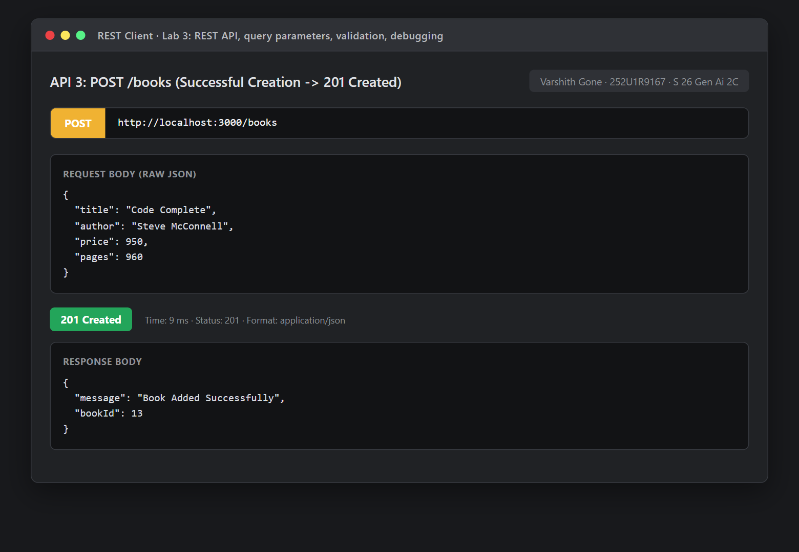

---

### 10. PUT `/books/:bookId` (Successful Update)
Status: `200 OK`. Updates existing book fields and returns `{ "message": "Book Details Updated" }`.

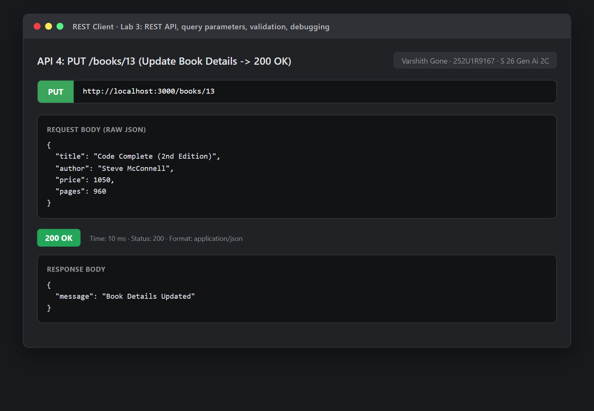

---

### 11. PUT `/books/9999` (Update Non-Existent ID)
Status: `404 Not Found`. Rejects update when `changes === 0`.

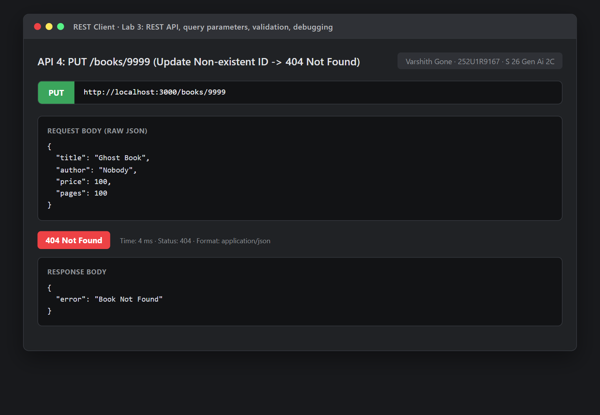

---

### 12. DELETE `/books/:bookId` (Successful Deletion)
Status: `200 OK`. Deletes the book and returns `{ "message": "Book Removed" }`.

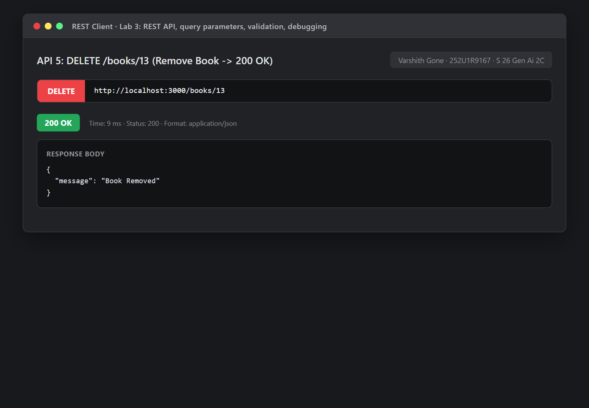

---

### 13. GET `/books/:bookId` (Verify Deletion)
Status: `404 Not Found`. Confirms that the deleted book is no longer in the database.

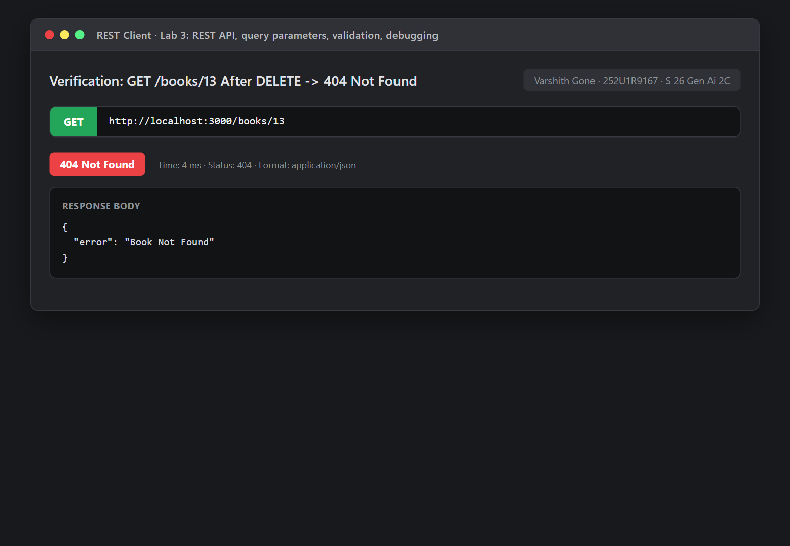

---

## Debugging Exercise: Common Errors and Solutions

In this module, 4 typical backend bugs were analyzed and solved:

### 1. Port Conflict (`EADDRINUSE`)
- **Symptoms:** Server startup crashes with `Error: listen EADDRINUSE: address already in use :::3000`.
- **Cause:** Another instance of Node.js or a separate service is already actively listening on port `3000`.
- **Solution:**
  1. Identify and kill the occupying process using `netstat -ano | findstr :3000` and `taskkill /PID <PID> /F` (or `Stop-Process` in PowerShell).
  2. Implement flexible port binding using `const PORT = process.env.PORT || 3000`, allowing dynamic configuration via environment variables without hardcoded collisions.

### 2. Wrong Import Path
- **Symptoms:** `MODULE_NOT_FOUND` error or `TypeError: open is not a function`.
- **Cause:** Mixing up `sqlite` (the Promise-based wrapper) with `sqlite3` (the low-level driver), or providing an incorrect relative path to `database.db`.
- **Solution:**
  1. Import both correctly:
     ```javascript
     const { open } = require('sqlite');
     const sqlite3 = require('sqlite3');
     ```
  2. Use `path.join(__dirname, 'database.db')` instead of relative string paths like `'./database.db'` to guarantee cross-platform resolution regardless of process working directory.

### 3. Table-Name Typo (`no such table`)
- **Symptoms:** SQLite error: `SQLITE_ERROR: no such table: books` or `no such table: tbl_book`.
- **Cause:** The SQL statement referred to `books` (plural), whereas the table was defined as `book` (singular) in the DDL statement.
- **Solution:** Standardize the schema name consistently across `CREATE TABLE book (...)`, `SELECT FROM book`, `INSERT INTO book`, `UPDATE book`, and `DELETE FROM book`.

### 4. Missing `await` in Database Calls
- **Symptoms:** The route handler sends `[object Promise]` or empty JSON `{}` back to the client, or causes unhandled promise rejections.
- **Cause:** Calling `db.all()`, `db.get()`, or `db.run()` without `await`. The JavaScript event loop moves to `response.json()` before the I/O operation finishes on disk.
- **Solution:** Ensure the enclosing route handler is marked `async (request, response) => { ... }` and prefix every database method invocation with `await` (e.g., `const books = await db.all(...)`).

---

## Viva Questions & Answers

### 1. Query parameter vs path parameter?
- **Path Parameter (e.g. `/books/:bookId`):**
  - Used to identify a specific, unique resource in the hierarchy.
  - Essential to the identity of the resource (e.g. book with ID `5`).
  - Cannot be omitted without changing the routing destination.
- **Query Parameter (e.g. `/books?search_q=Harry&order_by=price`):**
  - Used to filter, sort, search, or paginate a collection of resources.
  - Optional parameters appended after `?` as key-value pairs separated by `&`.
  - Omitting them falls back to default collection settings without breaking the route.

### 2. What does stateless mean in REST?
- **Statelessness** means that each client request to the server must contain all of the contextual information necessary for the server to understand and process it.
- The server does not store client session state between requests on its memory.
- Benefits include high scalability (any server instance can handle any incoming request), simplified caching, and reliability during server restarts.

### 3. Which status code for bad input vs a missing record?
- **Bad Input (`400 Bad Request`):** Used when the client sends malformed syntax, missing required fields (e.g. missing `title`), or invalid data types (e.g. string passed for numeric `price`). The client should fix their payload before retrying.
- **Missing Record (`404 Not Found`):** Used when the request URI and syntax are valid, but the target resource ID does not exist in the database (e.g. `GET /books/999`).

---

## Notes: Problems Faced and Solutions

1. **Preventing SQL Injection in Dynamic `ORDER BY`:**
   - *Problem:* SQL placeholders (`?`) cannot be used for SQL identifiers like column names (`ORDER BY ?`) or sort keywords (`ASC`/`DESC`).
   - *Solution:* Implemented a strict whitelist validation check:
     ```javascript
     const allowedColumns = ['id', 'title', 'author', 'price', 'pages'];
     const safeOrderBy = allowedColumns.includes(order_by) ? order_by : 'id';
     const safeOrder = order.toUpperCase() === 'DESC' ? 'DESC' : 'ASC';
     ```
     This completely prevents SQL injection while allowing dynamic column sorting.

2. **Automated Live Screenshot Generation with Playwright:**
   - *Problem:* Manual screenshot capture across 13 scenarios is tedious, error-prone, and inconsistent.
   - *Solution:* Created `take-screenshots.js` using Playwright with Google Chrome. The script starts a live Express server, triggers real `fetch` requests inside Chrome for each scenario, updates the DOM with live timing and status badges, and takes high-resolution full-page screenshots.
